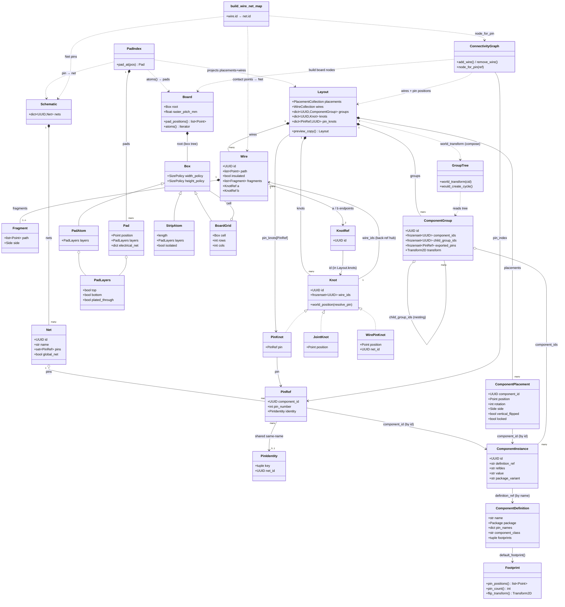

<!-- SPDX-License-Identifier: MIT -->
# Domain data model

The entities of the domain (`src/protoboard/domain/`) and their relations,
faithful to the code. The core idea: the model is a graph of **logical nets**
(the schematic / netlist); the **physical view** is the projection of that graph
onto a grid of holes on the board.

Three conceptual groups:

- **Schematic** (logical) — `Schematic → Net → PinRef`. No geometry.
- **Layout** (physical) — `Placement → Instance → Definition → Footprint`,
  wires, knots, groups.
- **Board** (substrate) — a tree of boxes resolving to pad positions.
- **Connectivity** (projection) — union-find over pad points; `wire → net` map.

`PadIndex` and `ConnectivityGraph` are **runtime projections** built from
Board + Layout + Schematic, not persisted state (dashed relations below).

## Fidelity notes

- **`ComponentDefinition` has no `footprint` field** — the only stored geometry
  is `package: Package`; a `Footprint` is obtained via `default_footprint()` /
  `ComponentInstance.resolved_footprint()`. (Historical `defn.footprint` was
  removed 2026-07-04.)
- **`ComponentInstance.definition_ref` is a `str`** (the definition *name*), not
  a UUID — bound through a `dict[str, ComponentDefinition]` catalogue.
- **`Knot` is a `Protocol`** with three frozen implementers (`PinKnot` /
  `JointKnot` / `WirePinKnot`). `Wire.a`/`b` are `KnotRef` (id-only), resolved
  against `Layout.knots` — deliberately indirect.
- **`PadIndex` / `Pad` / `ConnectivityGraph` are runtime projections** (mutable,
  rebuilt from Board + Layout + Schematic), not part of the persisted model —
  shown with dashed dependency relations.
- **`PlacementCollection` composes group transforms on read**: value reads
  return the world placement (local folded through the ancestor-group
  transform); writes store the raw local. `Layout.preview_copy()` (E5) forks a
  scratch layout that copies placements / wire path+fragments / knots and shares
  `groups` + resolvers.
- **Frozen vs mutable**: `PinRef`, `KnotRef`, the three `Knot`s,
  `ComponentGroup`, `ComponentInstance`, `ComponentDefinition` are frozen;
  `Layout`, `ComponentPlacement`, `Wire`, `Fragment`, `Net`, `Schematic`, `Pad`
  are mutable (the runtime-edited state).
