<!-- SPDX-License-Identifier: MIT -->
# Module dependencies & layers

High-level map of the real dependency edges between layers, derived from the
actual import graph (`grep`/read), not from the declared architecture. Renders
natively on GitHub (Mermaid).

The declared stack (CLAUDE.md §3) is:

```
GUI (PySide6)
  ↑ Qt signals
Application / Controller (EditController, Tools, Selection)
  ↑ Commands
Domain Model (pure Python — MUST NOT import Qt)
  ↑
Services (DRC, Router, KiCAD I/O, Persistence, Export)
```

The **seam** is `EditController` (`services/editing/controller.py`), typed
against the `EditState` protocol. Both the GUI `EditorSession` and the headless
`HeadlessSession` satisfy it, so GUI tools and the headless CLI drive the *same*
verbs on one controller instance — `EditorSession(HeadlessSession, QObject)`
inherits the headless implementation and only adds Qt.

## Diagram

```mermaid
graph TD
    subgraph GUI["GUI — PySide6"]
        MW[main_window]
        BV["board_view / AbstractBoardView"]
        TH[tool_host]
        SC[scene_composer]
        SEL["selection/service"]
        HL["highlight/controller+renderer"]
        TOOLS["tools/*"]
        RND["renderers/*"]
        PORTS["ports/* — Qt-free DTO"]
        DCD["tools/drag_commit_decision — Qt-free DTO"]
        THEME["theme / layer_state"]
        SESS["session::EditorSession"]
    end

    subgraph APP["Application / Controller — Qt-free"]
        EC["editing/controller::EditController"]
        ES["«protocol» EditState"]
        HS["editing/headless_session::HeadlessSession"]
        CLI["editing/cli"]
        AT[editing/armed_transform]
        PS[editing/preview_state]
        DD[drag_detector]
        DGC[editing/drag_commit]
    end

    subgraph SVC["Services"]
        AR[routing/autorouter]
        ASTAR[routing/astar]
        RS[("routing/astar_rs — Rust")]
        CM[routing/cost_model]
        HIER[routing/hierarchical]
        PROTO["routing/protocol — registry"]
        DRCE[drc/engine]
        PY[persistence/project_yaml]
        BY[persistence/board_yaml]
        EXP["export/* — Qt"]
        KIC["kicad/* — parser/importer/exporter"]
        DBG["debug_trace — imports Qt!"]
    end

    subgraph DOMAIN["Domain Model — declared Qt-free"]
        BOARD[board]
        COMP[components]
        SCHEM[schematic]
        LAYOUT[layout]
        CONN[connectivity]
        CMDS["commands / CommandStack"]
    end

    %% GUI internal
    MW --> BV
    MW --> SESS
    BV --> TH
    BV --> SC
    BV --> SEL
    BV --> HL
    TH --> TOOLS
    TH --> PORTS
    SC --> RND
    SC --> NS[routing/net_status]
    SESS -. inherits .-> HS

    %% Controller seam
    HS --> EC
    EC -. typed by .-> ES
    HS -. satisfies .-> ES
    SESS -. satisfies .-> ES
    CLI --> HS
    TOOLS --> EC

    %% EditController outbound verbs (lazy/local imports)
    EC --> AR
    EC --> PROTO
    EC --> DRCE
    EC --> PY
    EC --> EXP
    EC --> CMDS

    %% routing internals
    AR --> ASTAR
    ASTAR -. optional .-> RS
    ASTAR --> CM
    AR --> CM
    HIER --> AR

    %% persistence
    PY --> BY

    %% Services -> Domain (legit downward)
    AR --> DOMAIN
    DRCE --> DOMAIN
    PY --> DOMAIN
    EXP --> DOMAIN
    KIC --> DOMAIN

    %% === Layer VIOLATIONS (upward services -> gui, runtime) ===
    DD -->|"runtime ⚠"| DCD
    AT -->|"runtime ⚠"| PORTS
    PY -->|"runtime ⚠"| THEME
    EXP -->|"runtime ⚠"| THEME
    EXP -->|"runtime ⚠"| RND

    %% === Transitive Qt leak into domain ===
    COMP -->|"@traced ⚠"| DBG

    classDef qtfree fill:#e8f5e9,stroke:#2e7d32,color:#1b5e20;
    classDef qttaint fill:#ffebee,stroke:#c62828,color:#b71c1c;
    class DOMAIN,BOARD,COMP,SCHEM,LAYOUT,CONN,CMDS qtfree;
    class DBG,EXP qttaint;
```



## Reading the diagram

- **Green** nodes are (declared) Qt-free. **Red** nodes import Qt.
- Solid arrows = imports / calls. Dashed = protocol satisfaction / inheritance.
- Arrows labelled **⚠** are edges that violate the declared layer direction —
  see below.

## The seam: EditController / EditState

- `EditState` (`services/editing/controller.py`) is a `@runtime_checkable`
  `Protocol`. `HeadlessSession` (`services/editing/headless_session.py`)
  satisfies it directly; `EditorSession` (`gui/session.py`) **is a**
  `HeadlessSession` + `QObject` (adds the `layout_changed` signal).
- One `EditController` per session (`headless_session.py`, lazy
  `edit_controller` property). GUI tools and the CLI (`editing/cli.py`) call the
  same verbs on it: `delete` / `rotate` / `flip` / `place_component` /
  `add_wire` / `begin_transform` / `apply_autoroute` / `run_drc` / `save` /
  `export`.
- Every outbound service call from `EditController` uses a **lazy/local import**
  (routing, drc, persistence, export) so the verb layer itself stays Qt-free —
  the Qt-heavy export code is only imported inside `export()`.

## Known layer violations (as of 2026-07)

These are real edges in the runtime import graph that invert the declared
"services below GUI" direction. Flagged for visibility, not necessarily bugs —
several move Qt-free DTOs, following an established precedent.

1. **services → gui (upward), runtime, top-level imports**
   - `services/drag_detector.py` → `gui.tools.drag_commit_decision`
     (`DragCommitDecision`, Qt-free DTO)
   - `services/editing/armed_transform.py` → `gui.ports` (`WheelInput`,
     `WheelNotchAccumulator`; Qt-free input DTOs)
   - `services/persistence/project_yaml.py` → `gui.layer_state`
     (`LayerOverrides`, `LayerVisibility`)
   - `services/export/{snapshot,paint,png,pdf,svg}.py` → `gui.{theme,
     layer_state,renderers}` (export drives the GUI renderers to rasterise)

2. **domain → services → Qt (transitive Qt leak)**
   - `domain/components/package/{solver,loader,reach,shapes}.py` →
     `services/debug_trace` → `PySide6.QtCore` (top-level, unguarded).
   - The domain source is Qt-free in *content*, but importing these package
     modules pulls in `PySide6.QtCore` at runtime through the `@traced`
     decorator. The rule "domain must be testable without a display server"
     holds behaviourally (offscreen), but the import graph is not strictly
     clean.

3. **gui → services (downward, legitimate)**
   - `gui/scene_composer.py` → `services.routing.net_status.routed_net_ids`.
     This is the declared direction (GUI consuming a service), listed only for
     completeness.

> These reflect what was true at the time of writing. Before acting on any of
> them, re-check the file still imports what's claimed.
