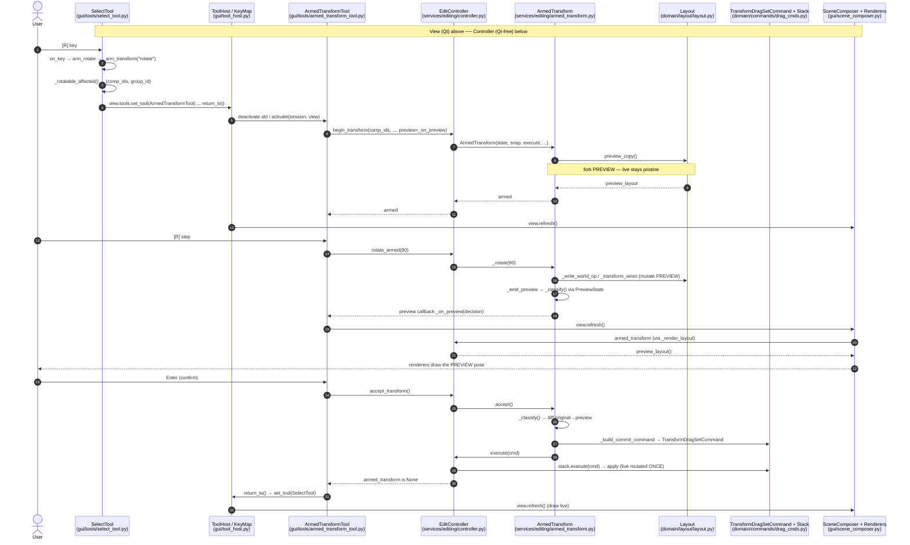
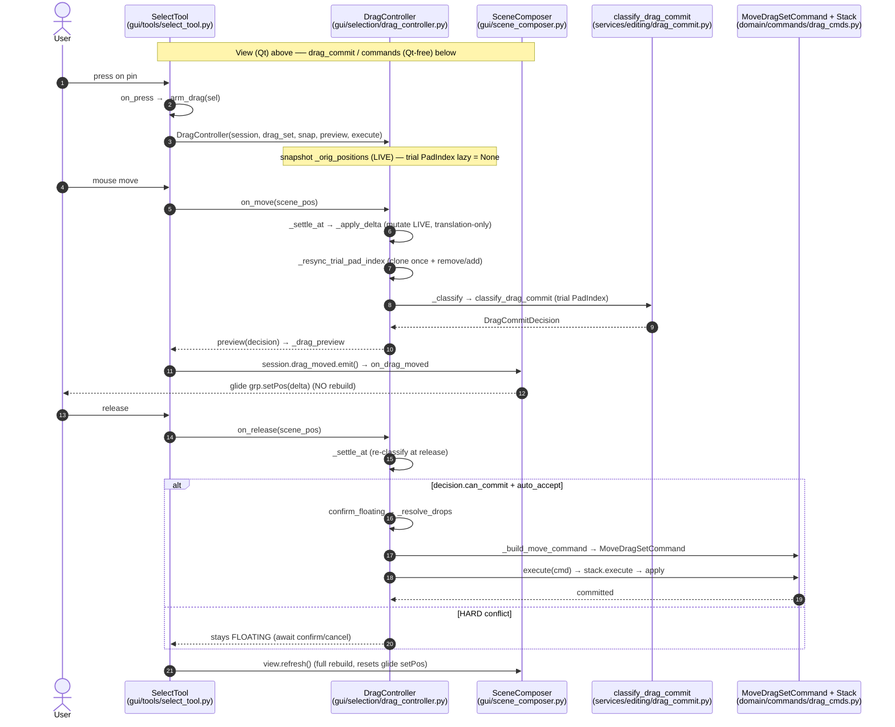
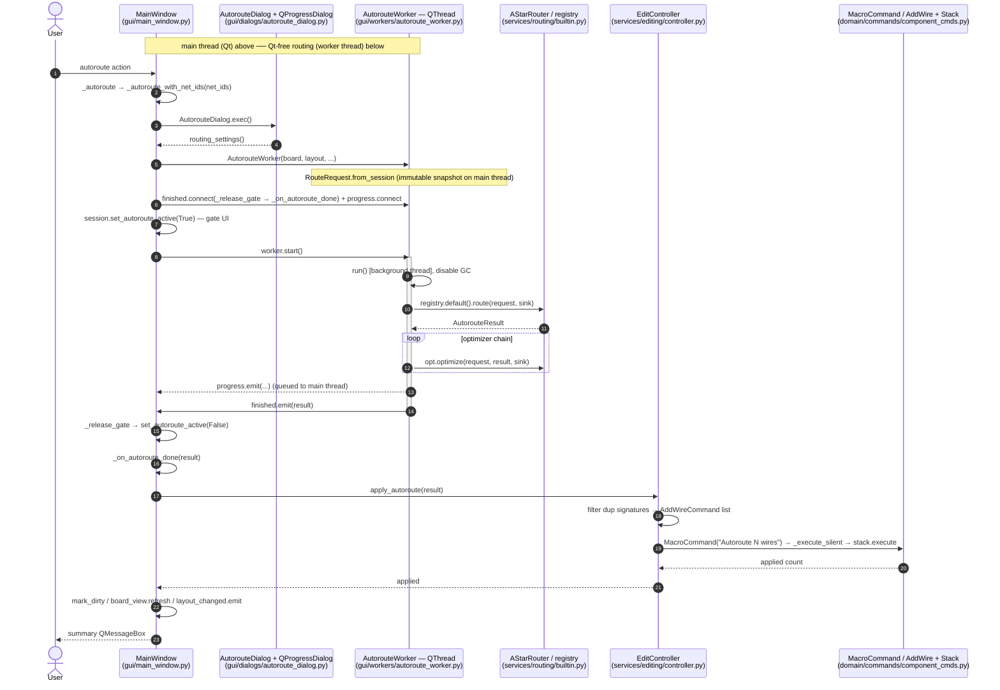

<!-- SPDX-License-Identifier: MIT -->
# Sequence flows

Call-level sequences for the three most important interactions, faithful to the
real method names. The **Qt-free boundary** is at the entry to `EditController`
(`services/editing/controller.py`) and downward — View + Tools +
SceneComposer/Renderers are the Qt layer; `KeyMap` (orchestrated by `ToolHost`)
is the View↔Controller seam.

- **[1] Armed rotate (E5)** — arm → step → accept, on the preview-model.
- **[2] Drag-commit** — mouse drag of a component (contrast: trial PadIndex +
  glide, vs armed's preview-copy + full refresh).
- **[3] Autoroute** — background `QThread`, Qt-free router, apply on the stack.

---

## [1] Armed rotate (E5 preview-model)

Key contrast with drag: a rotate/flip changes body orientation, which a cheap
`setPos` glide cannot show — so each step does a full `view.refresh()` that draws
the **preview** layout (`_render_layout()` returns `armed.preview_layout()` while
armed). The live layout is mutated exactly once, at accept.

---

## [2] Drag-commit (mouse drag)

Contrast with armed:

| | Drag | Armed transform |
|---|---|---|
| pose store | mutates **live** layout in-place | mutates a **preview** copy |
| conflict model | **trial PadIndex** (clone + resync) | `PreviewState` over the preview |
| live feedback | **glide** `grp.setPos(delta)` (no rebuild) | full `view.refresh()` |
| ops | translation only | rotate / move / flip |

---

## [3] Autoroute (background QThread)

The worker snapshots an immutable `RouteRequest` **on the main thread** (no race
with GUI mutations), routes on the background thread (Qt-free), and applies the
result on the main thread as one `MacroCommand` on the stack. GUI never calls
the synchronous `EditController.autoroute` (that variant is for the CLI); both
paths share `apply_autoroute`.

