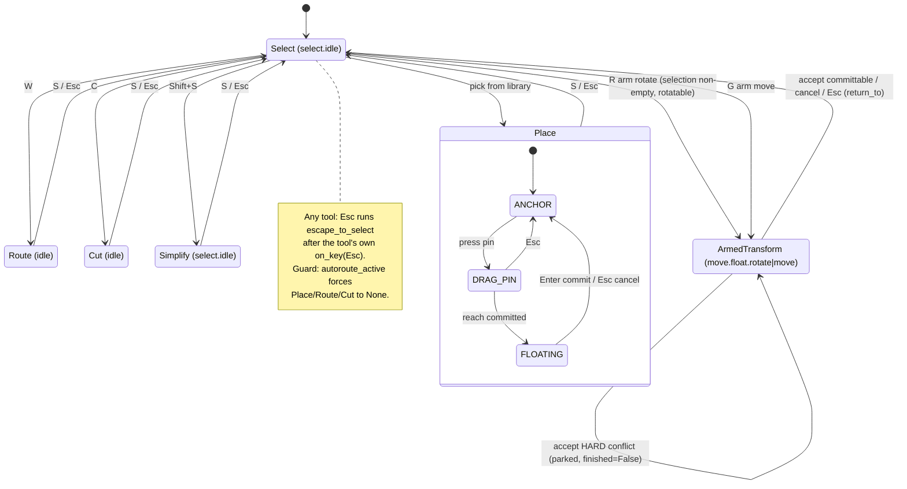
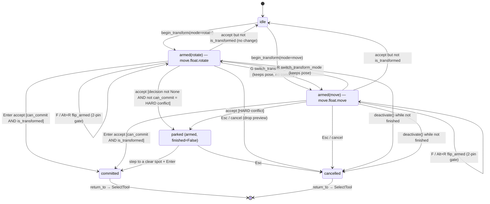
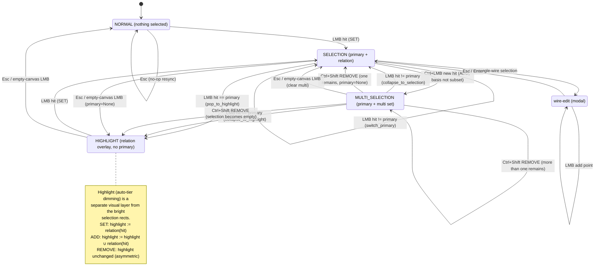

<!-- SPDX-License-Identifier: MIT -->
# State machines (tools / FSM)

Three state machines reconstructed from the code, with guards quoted from the
source. Renders on GitHub (Mermaid `stateDiagram-v2`).

- **[1] Tool lifecycle** — which tool is active, how the app switches between
  them (`gui/tool_host.py`, `gui/tools/*`).
- **[2] Armed-transform** — the armed rotate/move/flip sub-machine
  (`services/editing/armed_transform.py` + `gui/tools/armed_transform_tool.py`).
- **[3] Selection / highlight** — the 4-layer selection stack + highlight
  (`gui/selection_fsm.py`, canonical spec `docs/highlight-state-machine.txt`).

---

## [1] Tool lifecycle / tool-switching

`ToolHost.set_tool()` deactivates the old tool, pops its KeyMap layer, activates
the new one, pushes its KeyMap layer, and fires `view.refresh()`. Escape is
two-stage: the active tool gets `on_key(Esc)` first (internal cancel), then
`escape_to_select()` always runs → `_tool_select` in `MainWindow`.

`ArmedTransformTool` is the first **tool-self-transition**: SelectTool on
`[R]`/`[G]` does `set_tool(ArmedTransformTool(..., return_to=...))`, and the
armed tool calls the injected `return_to` on accept/cancel to hand control back.

Guard: while `session.autoroute_active`, `set_tool` forces any non-SelectTool to
`None` (`tool_host.py`).

---

## [2] Armed-transform (E5 preview-model)

`state` = `move.float.{mode}` while `armed and not armed.finished`, else
`select.idle`.

The whole gesture mutates a **preview** layout (`live.preview_copy()`); the live
layout stays pristine until accept commits one `TransformDragSetCommand`.

Guards, quoted from `services/editing/armed_transform.py`:

- **switch-mode keeps the pose** (`_enter_mode`): changing `rotate`↔`move` only
  re-aims the arrow keys — no transform step, no commit.
- **accept → conflict-park**: `if decision is not None and not
  decision.can_commit:` → status message, `_emit_preview()`, `return` — leaves
  `finished == False`, so the tool stays armed (conditional disarm). Conflict is
  classified against the **preview** pose via `PreviewState`.
- **cancel**: `finished = True`, nothing to undo (live never mutated), preview
  dropped.

---

## [3] Selection / highlight

Canonical source: `docs/highlight-state-machine.txt` (spec rev 3). Four stack
layers (`gui/selection_fsm.py::StackLayer`): `NORMAL` / `HIGHLIGHT` /
`SELECTION` / `MULTI_SELECTION`, plus a modal `wire-edit` state entered with
`[E]` on a single-wire selection.

Set-op axis (`SelectTool._decode_modifiers`, rev 3): **SET** (plain LMB),
**ADD** (Ctrl), **REMOVE** (Ctrl+Shift), **RELATION** (Alt). Highlight is a
separate visual tier (auto-dimming) from the bright selection rectangles: SET
replaces it, ADD unions into it, REMOVE leaves it unchanged (asymmetric — the
only "clear all" is Esc).

> **Code ↔ spec note.** `gui/selection_fsm.py` still exposes `step_shift_lmb`
> (older Shift = multi semantics) alongside the newer `BasisScope`/`SetOp` axes.
> `SelectTool._decode_modifiers` implements the canonical rev-3 axis
> (Ctrl = ADD, Ctrl+Shift = REMOVE, Alt = RELATION). The diagram follows the
> canonical spec; the legacy `step_shift_lmb` path is a remnant of an earlier
> revision worth reconciling.
