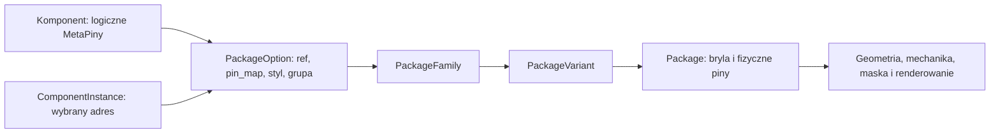
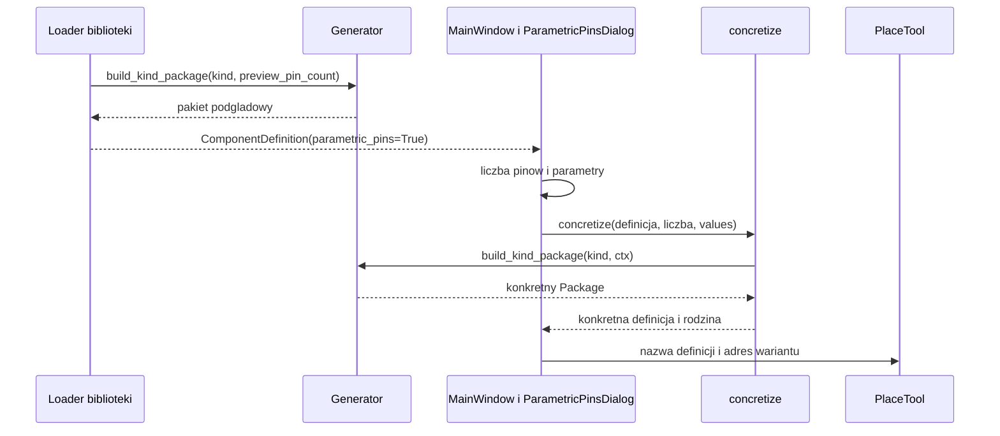
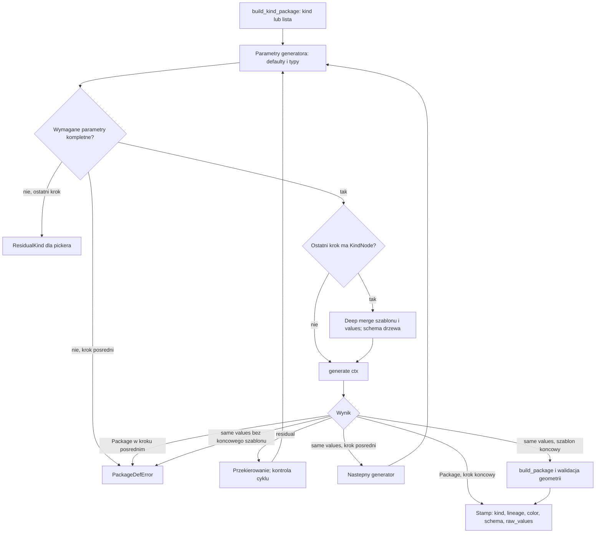
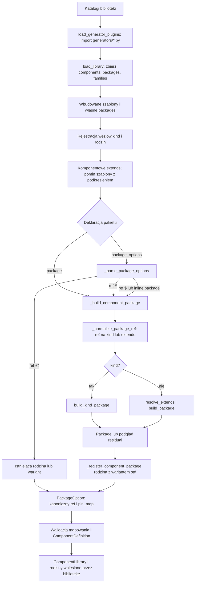
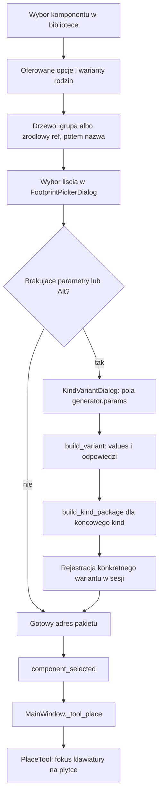
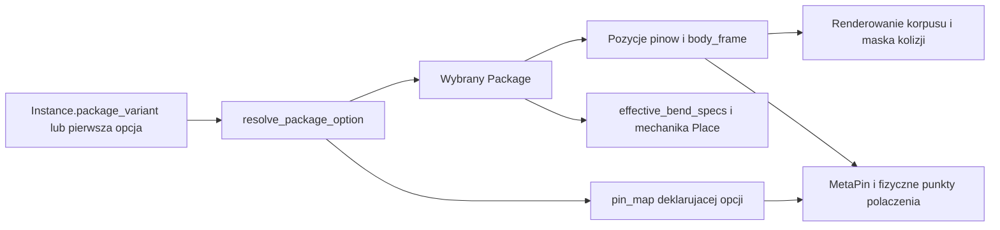

# Definiowanie komponentów i pakietów

Ten przewodnik opisuje aktualny format bibliotek YAML oraz drogę od deklaracji
do geometrii używanej przy wyborze i umieszczaniu komponentu. Jest wspólnym
miejscem dokumentacji komponentów, pakietów, rodzin, generatorów i ich
współpracy z pickerem. Przykłady zakładają dostęp do wbudowanych szablonów
z `assets/packages/`; nie wymagają kopiowania tych szablonów do biblioteki.

Kolejność czytania: model danych i definicje komponentów; geometria i jednostki;
schema; generatory i pluginy; przepływ kodu; weryfikacja biblioteki.
Przykłady YAML są kompletnymi plikami, chyba że towarzyszący opis wskazuje
zależność od pokazanego pluginu Python. Każdy plik można włożyć do katalogu
biblioteki wskazanego przez `component_library_dirs`.

## Jak wybrać sposób definicji

| Potrzeba | Najprostsza deklaracja |
| --- | --- |
| Istniejąca gotowa obudowa | Opcja `ref: "@rodzina/wariant"`. |
| Kilka gotowych rozmiarów wspólnych dla różnych komponentów | `families` z `variants`, oferowane przez `@rodzina`. |
| Wspólna geometria, która ma być uzupełniana lub nadpisywana | Szablon `packages` i `package: {extends: nazwa, ...}`. |
| Jedna kompletna nazwana geometria | `ref: "#nazwa"`. |
| Jeden korpus tylko dla danego komponentu | Komponentowe `package`. |
| Obudowa zależna od liczby pinów lub parametrów | `package: {ref: "$generator", ...}`. |
| Dwupinowy radialny prostopadłościan opisany nazwą rozmiaru | Nazwana opcja `ref: "$generic-prism"`. |
| Liczba pinów wybierana dopiero przy Place | Inline `ref: "$generator"` bez `meta_pins` i bez `package.pins`. |

Szablon geometrii i rodzina rozwiązują różne problemy. Szablon współdzieli
strukturę i parametry, a rodzina publikuje gotowe warianty do katalogu. Generator
wykonuje obliczenia; nie jest potrzebny do samego grupowania opcji w pickerze.


## Model i pliki biblioteki

`ComponentDefinition` opisuje logiczną część: klasę, nazwę, wartość i uporządkowaną
listę `MetaPin`. `Package` opisuje fizyczny korpus, wyprowadzenia i mechanikę
montażu. `PackageFamily` grupuje gotowe fizyczne warianty; `PackageOption` łączy
komponent z rodziną lub wariantem oraz określa mapowanie logicznych terminali na
fizyczne piny. Egzemplarz `ComponentInstance` wskazuje definicję i wybrany adres
pakietu; jego położenie i indywidualne zgięcia pinów należą do placementu.

Plik `*.yaml` może zawierać trzy niezależne listy:

| Sekcja | Zawartość | Kiedy używać |
| --- | --- | --- |
| `packages` | Nazwane definicje i szablony geometrii; wymagają `name`. | Dziedziczenie geometrii, wspólne wymiary, własne węzły generatorów. |
| `families` | Rodziny katalogowe z `family` i listą `variants`. | Gotowe warianty współdzielone przez różne komponenty. |
| `components` | Definicje komponentów z `name`. | Części oferowane w bibliotece; nazwy zaczynające się od `_` służą tylko jako szablony. |

Biblioteka jest skanowana rekurencyjnie (`**/*.yaml`). Dla komponentów i nazwanych
pakietów wygrywa wcześniejszy katalog, a w katalogu wcześniejszy alfabetycznie
plik. Wbudowane szablony pakietów z `assets/packages/` mają pierwszeństwo przed
zbieżną nazwą biblioteczną. Przekazany loaderowi katalog rodzin ma pierwszeństwo
przed rodzinami z plików komponentów. Wspólna pierwsza faza ładowania zbiera
definicje ze wszystkich plików, dlatego `extends` może wskazywać definicję z
innego pliku. Nieznane sekcje najwyższego poziomu są ostrzegane w logu.

## Definicja komponentu

| Pole | Znaczenie i wartość domyślna |
| --- | --- |
| `name` | Wymagana nazwa komponentu. |
| `meta_pins` | Wymagana niepusta lista dla części o stałej liczbie terminali; brak jest dopuszczony dla obsługiwanych definicji parametrycznych. |
| `component_class` | Klasa elektryczna; domyślnie `other`. Jest otwartym tagiem: nieznana wartość wywołuje ostrzeżenie, ale jest zachowywana. |
| `symbol` | Opcjonalny niepusty prefiks oznaczenia, np. `R`, `C`, `U`. |
| `description` | Opis tekstowy, domyślnie pusty. |
| `default_value` | Domyślna wartość egzemplarza; musi być tekstem, np. `"10k"`, `"?"`. |
| `metadata` | Dowolna mapa dodatkowych metadanych. |
| `style` | Wizualne nadpisanie koloru i promienia narożników komponentu. |
| `extends` | Nazwa szablonu komponentu. Pola dziecka zastępują całe pola rodzica. |
| `aliases` | Dodatkowe nazwy tej samej rozstrzygniętej definicji. |
| `package` | Jedna geometria; wzajemnie wyklucza `package_options`. |
| `pin_map` | Mapowanie dla komponentowego `package`; bez niego mapowanie 1:1. |
| `package_options` | Niepusta lista oferowanych rodzin, wariantów lub geometrii. |
| `footprint_style` | Domyślny styl opcji; styl konkretnej opcji nadpisuje go per właściwość. |

Znane klasy to `resistor`, `capacitor_polar`, `capacitor_nonpolar`, `inductor`,
`transformer`, `diode`, `diode_zener`, `diode_led`, `transistor_npn`,
`transistor_pnp`, `transistor_nmos`, `transistor_pmos`, `transistor_njfet`,
`transistor_pjfet`, `ic`, `devboard`, `connector`, `switch`, `fuse`, `crystal`,
`mechanical`, `other`.

Komponent musi jawnie deklarować `package` albo `package_options`. Loader nie
wnioskuje korpusu z liczby MetaPinów. Dawne pola komponentu `pins`, `pin_names`,
`footprints`, `package_family_ref` i `footprint` nie są obsługiwanym formatem.
Mechanika `bendable_pins` należy do pakietu; takie pole na poziomie komponentu
nie definiuje zasięgu pinów.

`style` ma składnię `color: #a85; corner-radius: 0.4`.
Kolor dopuszcza 3, 4, 6 lub 8 cyfr szesnastkowych; kanał alfa jest ostatni.
`corner-radius` przyjmuje od jednej do czterech nieujemnych liczb w mm,
z rozwinięciem jak CSS border-radius. Nieznana właściwość jest błędem.
Pierwszeństwo per właściwość: styl egzemplarza, styl opcji (z uwzględnieniem
`footprint_style`), styl komponentu, kolor/geometria pakietu, motyw.

### MetaPiny i mapowanie pinów

Każdy element `meta_pins` jest tekstową etykietą lub niepustą listą aliasów
jednego logicznego terminala, np. `[GND, VSS]`. Indeks jest 1-based i wynika
wyłącznie z kolejności listy. Etykieta `"15"` nie nadaje terminalowi indeksu 15.
Powtórzona etykieta w dwóch MetaPinach nie łączy ich elektrycznie.

`pin_map` ma postać `indeks MetaPina: [numery fizycznych pinów]`. Jednemu
terminalowi można przypisać zero, jeden lub wiele pinów. Każdy fizyczny pin może
wystąpić najwyżej raz w całej mapie. Pominięte `pin_map` daje
`meta_pins[n] -> package_pin[n]` w kolejności listy. Jawna mapa zastępuje ten
domyślny wynik w całości: nieobecne terminale pozostają niemapowane;
`pin_map: {}` nie mapuje żadnego terminala. Puste `[]` jawnie pokazuje terminal
niemający fizycznego odpowiednika w danym pakiecie.

Każda mapa jest sprawdzana względem liczby MetaPinów oraz fizycznych pinów
pakietu. Logiczny terminal bez mapowania zachowuje tożsamość w netliście, ale
nie dostaje fizycznego punktu połączenia w tym pakiecie.

### Jedna geometria, dziedziczenie komponentu i aliasy

Poniższy plik jest kompletną biblioteką opartą na wbudowanym generatorze:

```yaml
components:
  - name: _SENSOR_BASE
    component_class: connector
    symbol: J
    description: "Złącze czujnika"
    meta_pins: [[GND, VSS], SIGNAL, NC]
    package: {ref: "$sil", pins: 4}
    pin_map: {1: [1, 4], 2: [2], 3: []}
    style: "color: #303030; corner-radius: 0.2"
    metadata: {datasheet: "sensor.pdf"}

  - name: SENSOR
    extends: _SENSOR_BASE
    default_value: "SENSOR"
    aliases: [SENSOR_ALT]

  - name: DOC_REVERSED
    meta_pins: [A, B]
    package: {ref: "$sil"}
    pin_map: {1: [2], 2: [1]}

  - name: DOC_UNMAPPED
    meta_pins: [A, B]
    package: {ref: "$sil"}
    pin_map: {}
```

W tym przypadku domyślna geometria ma adres `SENSOR-package/std`. Komponentowe
`extends` jest płytkim scaleniem: nowe `meta_pins`, `pin_map`, `package` albo
`package_options` zastępuje całą odziedziczoną wartość. To inna reguła niż
rekurencyjne scalanie geometrii pakietów. Szablon powinien korzystać z tej samej
formy pakietu co dziecko: odziedziczonego `package` nie można równocześnie
uzupełnić o `package_options`.

### Opcje pakietów i prefiksy referencji

Opcja dopuszcza dokładnie pola `name`, `ref`, `package`, `pin_map`, `group` i
`style`. Musi zawierać `ref` albo wewnętrzny `package`; nie wolno podawać obu.
Geometria obok `ref` jest błędem; własne wymiary umieszcza się w `package`.
Łańcuch tekstowy jest skrótem opcji zawierającej samo `ref`.

| Prefiks | Znaczenie |
| --- | --- |
| `@family/variant` | Istniejący, gotowy wariant katalogowy. |
| `@family` | Wszystkie istniejące warianty tej rodziny; domyślnie wariant wskazany przez `default` rodziny lub pierwszy. |
| `#name` | Nazwana definicja z `packages`, materializowana przez `extends: name`; musi być kompletna w tym miejscu. |
| `$kind` | Zarejestrowany generator, uruchomiony dla tej opcji; musi dać gotowy pakiet bez dodatkowych pytań. |

Prefiksy są składnią źródłowego YAML i należy ujmować je w cudzysłów. Rozstrzygnięte
adresy runtime nie mają prefiksu. `#` nie oznacza automatycznie kompletnej
definicji: może wskazywać szablon, ale skrót `ref: "#..."` bezpośrednio w opcji nie pozwala
dopisać brakujących wymiarów. W takim przypadku należy zastosować
`package: {ref: "#nazwa", ...}` albo `package: {extends: nazwa, ...}`.

Wybór pakietu jest ograniczony do opcji komponentu. Zgodna liczba pinów ani
istnienie innego pakietu w katalogu nie uprawnia do jego wybrania. Dla wielu
opcji pierwsza stanowi geometrię domyślną przed wyborem egzemplarza.

W YAML można użyć kotwic, np. `pin_map: {1: &p1 [1], 2: &p2 [2]}`, a w
kolejnej opcji `pin_map: {1: *p1, 2: *p2}`. `&p1` nazywa wartość, a `*p1`
wstawia tę samą wartość; to standard YAML, niezwiązany z prefiksami referencji
pakietów ani z numerowaniem MetaPinów.

Poniższy samodzielny przykład pokazuje `@family`, `@family/variant`, `#name`,
pakiet inline wewnątrz opcji oraz skrót tekstowy:

```yaml
packages:
  - name: doc-box
    extends: prism_radial
    dims: {lx: 7.2, ly: 2.5, lz: 6.5}
    leads: {body_offset: 5.0}

families:
  - family: doc/foil
    label: "Kondensatory foliowe"
    extends: doc-box
    default: large
    color: "#b09040"
    variants:
      - id: small
        dims: {lx: 7.2, ly: 2.5, lz: 6.5}
      - id: large
        dims: {lx: 10.0, ly: 5.0, lz: 15.0}

components:
  - name: DOC_FOIL
    component_class: capacitor_nonpolar
    symbol: C
    default_value: "?"
    meta_pins: [P1, P2]
    footprint_style: "color: #a85"
    package_options:
      - {name: Catalog, group: "Foil/Catalog", ref: "@doc/foil"}
      - {name: Fixed, ref: "@doc/foil/small", style: "color: #aa5"}
      - {name: Named, ref: "#doc-box"}
      - name: Own
        group: Foil
        package:
          ref: "#doc-box"
          dims: {ly: 3.5}
      - "@doc/foil/large"
```

Wariant rodziny dziedziczy wszystkie nieorganizacyjne pola rodziny.
`dims`/`leads` są uzupełniane mapami wariantu, a następnie rozwiązywany jest
łańcuch `extends` pakietu. Adresy mają postać `doc/foil/small`; ostatni segment
to identyfikator wariantu. Nazwa rodziny nie może być jednocześnie pełnym adresem
wariantu innej rodziny. Lista `variants` nie może być pusta.

Pełny katalog zawiera także rodziny tworzone przez
`domain/components/package/generated_families.py`: `dip-N` i `wdip-N` dla
parzystych N od 4 do 64 oraz `sil-N` dla N od 3 do 40, każdą z wariantem `std`.
Odwołanie `@dip-8/std` wybiera gotowy element katalogu, natomiast
`package: {ref: "$dip_ic"}` uruchamia generator dla danego komponentu. To dwie
osobne drogi do obudowy DIP.

### Wspólny zapis `ref` wewnątrz `package`

Komponentowe `package` i `package` zagnieżdżone w opcji korzystają z tej samej
składni: `ref: "$pin_header"` wybiera generator, a pozostałe pola przekazują
parametry, np. `rows: 2`. Tak samo `ref: "#doc-box"` wybiera nazwany szablon
i pozwala uzupełnić jego `dims` lub `leads`, jak w powyższej opcji `Own`.
Zwykłe `extends` dla geometrii pozostaje obsługiwane.

Referencje katalogowe `@rodzina/wariant` i `@rodzina` deklaruje się wyłącznie
bezpośrednio w `package_options`; nie są dozwolone w wewnętrznym `package`.
`ref` nie można łączyć w jednym `package` z `kind` ani `extends` — wybór
źródła musi być jednoznaczny. Nie wolno też przenosić parametrów geometrii
obok skrótowego `ref` opcji; wtedy należy użyć zagnieżdżonego `package`.

Dla dotychczasowych bibliotek zapis `package: {kind: pin_header, rows: 2}`
nadal jest akceptowany. Nowe definicje używają `ref: "$pin_header"`;
loader normalizuje je w jednym miejscu do wewnętrznego `kind`. Pole `kind`
pozostaje właściwą deklaracją wiązania generatora w sekcji `packages` oraz
nazwą używaną przez rejestr generatorów, wynikowy `Package` i renderer.

### Grupy i drzewo pickera

Ścieżka prezentacji to `{group albo źródłowe ref}/{name}`. Każdy `/` w dowolnym
z tych pól tworzy poziom drzewa; puste segmenty są pomijane, a ostatni segment
jest wybieralnym liściem. Jawne `group: ""` usuwa domyślną grupę. Opcja inline
bez `group` i `ref` korzysta tylko z `name`. Odwołanie do całej rodziny rozwija
się do liści, dodając `/variant_id` do nazwy opcji. To organizacja prezentacji,
nie zmiana technicznego adresu geometrii.

```yaml
components:
  - name: DOC_C_FOIL
    component_class: capacitor_nonpolar
    symbol: C
    meta_pins: ['1', '2']
    package_options:
      - {name: "5mm@7.2x2.5x6.5", ref: "$generic-prism", group: "Foil/Polymer"}
      - {name: "5mm/7.2x3.5x7.2", ref: "$generic-prism", group: "Foil/Polymer"}
```

Pierwsza ścieżka to `Foil → Polymer → 5mm@7.2x2.5x6.5`, druga to
`Foil → Polymer → 5mm → 7.2x3.5x7.2`. Bez `group` obie opcje trafiłyby pod
`$generic-prism`. Generator obsługuje oba separatory, ale `/` ma dodatkowo
znaczenie dla drzewa.

### Stała i zmienna liczba pinów, otwarte parametry

```yaml
components:
  - name: DOC_HEADER_6
    component_class: connector
    meta_pins: [P1, P2, P3, P4, P5, P6]
    package: {ref: "$pin_header", rows: 2}

  - name: DOC_HEADER_CHOOSE_ROWS
    component_class: connector
    meta_pins: [P1, P2, P3, P4, P5, P6]
    package_options:
      - name: Header
        package: {ref: "$pin_header", rows: null}

  - name: DOC_PIN_CLOUD
    meta_pins: [A, B, C]
    package: {ref: "$generic"}
```

Pierwszy komponent ma zawsze sześć terminali w dwóch rzędach. Drugi zostawia
liczbę rzędów otwartą w pickerze; liczba logicznych terminali jest stała.
Trzeci komponent jawnie żąda prostego korpusu nad chmurą pinów; nie jest
niejawnym fallbackiem dla brakującego pakietu. Definicje ze zmienną liczbą
pinów opisuje osobny przykład w rozdziale o generatorach.

`package.pins` w generatorze może oznaczać fizyczną liczbę pinów różną od liczby
MetaPinów; wtedy odpowiednie `pin_map` jest szczególnie istotne. Dla deklaracji
geometrii bez generatora fizyczna liczba wynika z N−1 kroków `body_offset`.
Skrótowe odwołania `ref: "$..."` i `ref: "#..."` bezpośrednio w opcji muszą
zostać całkowicie rozwiązane podczas ładowania. Otwarte parametry w opcji
należy deklarować przez jej wewnętrzny `package`, również z polem `ref`.

## Geometria pakietu

### Pola i jednostki

| Pole | Znaczenie |
| --- | --- |
| `name` | Nazwa w sekcji `packages`; inline jest nadawana przez loader. |
| `abstract` | Szablon niebudowany samodzielnie podczas `load_packages`; potomkowie mogą z niego korzystać. |
| `extends` | Rodzic geometrii; mapy scalają się rekurencyjnie, listy i skalary są zastępowane. Konkretna wartość dziecka może nadpisać konkretną wartość rodzica. |
| `shape` | `cylinder`, `prism` lub `disc`; wybiera implementację geometrii. |
| `dims` | Wymiary w mm, zależne od kształtu. |
| `leads` | Kierunki wyjścia, kroki pomiędzy pinami, ewentualne parametry solvera. |
| `arrangement` | `axial` albo `radial`; opisuje ułożenie korpusu/wyprowadzeń, nie zastępuje ich współrzędnych. |
| `bend` | Zapas zgięcia w jednostkach otworów; domyślnie 0. |
| `bendable_pins` | Jawna mechanika poszczególnych fizycznych pinów; ma pierwszeństwo przed wyliczaną. |
| `edge` | `sharp` lub `rounded`; domyślnie prism: sharp, cylinder/disc: rounded. |
| `color` | Domyślny kolor korpusu; nadpisywany przez style. |
| `margin` | Dla pryzmatu: margines od bbox środków pinów w mm, jeśli nie ma jawnych lx/ly. |
| `mount` | Dla pryzmatu: `through_hole` (domyślnie) albo `surface`. |
| `mount_points` | Opcjonalna lista wektorów sąsiednich padów pin-2, w otworach; nie jest sekwencją pozycji pinów. |
| `disc_profile` | Dla dysku: `flat` lub `candy`. |
| `schema` | Deklaracje pól, wartości domyślne i typy. |
| `ref` | W komponentowym `package`: generator `$nazwa` lub szablon `#nazwa`, z dodatkowymi parametrami. |
| `kind` | W deklaracji węzła `packages`: powiązanie z generatorem; także wewnętrzny identyfikator w kodzie. |

Nie należy stosować `mount_points` jako ogólnego sposobu wyrażania dowolnego
rastra złącza. Do tego służy jawny `leads.body_offset`/`board_offset`.

| Kształt | Pola `dims` |
| --- | --- |
| `cylinder` | Wymagane `diameter`, `length`; opcjonalne `edge_radius`, `flat_radius` (alias `flat_r`) i `flat_normal`. |
| `disc` | Wymagane `diameter`, `thickness`; profil jest poza `dims`. |
| `prism` | `lx`, `ly` podaje się razem; `lz` jest opcjonalne po podaniu pary, domyślnie 0; dodatkowo `corner_radius`. Bez lx/ly można użyć `margin` i bbox pinów. |

`lx` biegnie wzdłuż lokalnej osi wyprowadzeń, `ly` w poprzek w płaszczyźnie
płytki, `lz` jest wysokością nad płytką. Nie należy kopiować do pryzmatu starych
nazw `length`, `width`, `height`; loader zgłasza je jako błąd. W cylindrze
`length` pozostaje poprawną nazwą wymiaru.

Kanoniczny raster aplikacji to **2.5 mm**; nominalne 0.1 cala/2.54 mm jest
modelowane jako 2.5 mm. Pozycje pinów oraz placement są w jednostkach otworów;
wymiary korpusu, `lead_r`, `lead_length` i `body_eccentricity` są w mm.
Pryzmat bez jawnych wymiarów i bez `margin` nie ma fizycznego prostokąta
korpusu: renderowanie/maska korzystają z degradacji do pinów, a nie z ukrytego
wymiaru obudowy.

### Wyprowadzenia: kierunki, kroki i domeny

`leads.direction` akceptuje trzy zapisy: jeden wektor 3D dla wszystkich pinów,
listę wektorów po jednym na pin albo grupy `[[indeksy pinów], [x,y,z]]`.
W ostatniej postaci wszystkie fizyczne piny muszą mieć przypisany kierunek.

`leads.body_offset` zawiera N−1 kolejnych kroków od pinu i do i+1. Pin 1 ma
lokalną pozycję `[0,0]`, następne powstają przez sumowanie kroków. Lista nie
jest listą bezwzględnych współrzędnych. Można podać `[x,y]` jako pojedynczy
krok, `[[x,y], ...]` jako listę kroków oraz `[count,[x,y]]` wewnątrz listy jako
powtórzenie. `body_offset: 5.0` jest skrótem `[[5.0,0]]`, wyłącznie dla domeny
korpusu. Jawny `board_offset` wymaga wektora/listy, nie skalaru.

`body_offset` bez wrappera jest w mm. Wrapper `{unit: U, value: kroki}` mnoży
każdą składową przez U mm. `board_offset` jest zawsze w otworach i akceptuje:

| Wartość | Wynik |
| --- | --- |
| `default` albo brak pola | Kroki korpusu w mm podzielone przez 2.5 mm. |
| Lista kroków | Jawna geometria padów, niezależna od odległości wyjść z korpusu. |
| `solve` | Rozstaw obliczony przez solver cylindra osiowego; nie jest obsługiwany przez pryzmat/dysk. |

W szczególności `body_offset: {unit: 1.25, value: [[1,0],[1,0]]}` z
`board_offset: default` daje piny co **0.5 otworu**, nie co jeden otwór. Jeżeli
wyprowadzenia o rastrze 1.25 mm mają zostać rozsunięte do 2.5 mm, trzeba jawnie
podać kroki płytki `[[1,0],[1,0]]` i odpowiednią mechanikę.

### Przykłady geometrii: cylinder, dysk, pryzmat, RLE i nieregularne piny

Każdy komponent w tym kompletnym pliku jest używalną definicją. Wspólne
`packages` pokazują oba rodzaje mimośrodu; nie wolno podawać ich równocześnie.

```yaml
packages:
  - name: doc-axial
    extends: cylinder_axial
    dims: {diameter: 2.5, length: 6.3, edge_radius: 0.2}
    leads: {lead_r: 0.27, lead_length: 32.0, body_eccentricity: 0.0}

  - name: doc-spread-three
    extends: prism
    dims: {lx: 4.5, ly: 4.5, lz: 5.2}
    arrangement: radial
    leads:
      direction: [[0, 0, -1], [0, 0, -1], [0, 0, -1]]
      body_offset: {unit: 1.25, value: [[1, 0], [1, 0]]}
      board_offset: [[1, 0], [1, 0]]
      body_axis_pos: [1, 0]
    bendable_pins:
      2: {min_reach: 0, max_reach: 1, default: [0, 0]}
      3: {min_reach: 0, max_reach: 1, default: {x: 0, y: 0}}

components:
  - name: DOC_AXIAL
    component_class: resistor
    meta_pins: [A, B]
    package_options: [{name: Axial, ref: "#doc-axial"}]

  - name: DOC_DISC
    meta_pins: [A, B]
    package:
      extends: disc_radial
      dims: {diameter: 5, thickness: 2}
      disc_profile: candy
      leads: {body_offset: [5, 0]}
      bend: 1

  - name: DOC_ELECTROLYTIC
    component_class: capacitor_polar
    meta_pins: ['+', '-']
    package:
      extends: cylinder_radial
      dims: {diameter: 6.3, length: 11.0}
      leads: {body_offset: {unit: 2.5, value: [[1, 0]]}}

  - name: DOC_FLAT_CYLINDER
    component_class: transistor_npn
    meta_pins: [C, B, E]
    package:
      extends: cylinder_radial
      dims: {diameter: 4.5, length: 5.2, flat_radius: 1.6, flat_normal: [0, -1]}
      leads:
        direction: [0, 0, -1]
        body_offset: {unit: 1.25, value: [[1, 0], [1, 0]]}
        board_offset: [[1, 0], [1, 0]]

  - name: DOC_THREE
    meta_pins: [C, B, E]
    package: {ref: "#doc-spread-three"}

  - name: DOC_MODULE
    component_class: devboard
    meta_pins: [P1, P2, P3, P4, P5, P6, P7, P8]
    package:
      extends: prism_dil
      margin: [0, 2.5]
      leads:
        body_offset: {unit: 2.5, value: [[3, [0, 1]], [3, 0], [3, [0, -1]]]}

  - name: DOC_GROUPED
    meta_pins: [A, B, C, D]
    package:
      extends: prism
      dims: {lx: 8, ly: 4, lz: 2}
      leads:
        direction: [[[1, 2], [0, 0, -1]], [[3, 4], [0, 0, 1]]]
        body_offset: [[2.5, 0], [0, 5], [-2.5, 0]]
        board_offset: [[1, 0], [0, 2], [-1, 0]]

  - name: DOC_SMD
    meta_pins: [A, B]
    package:
      extends: prism_smd
      dims: {lx: 2.0, ly: 1.2, lz: 0.5, corner_radius: 0.1}
      mount_points: [[1, 0], [0, 1], [-1, 0], [0, -1]]
```

`DOC_MODULE` ma dwie kolumny po cztery piny: trzy kroki w dół, przeskok o trzy
otwory w bok i trzy kroki w górę. Margines ma kolejność CSS: jedna liczba —
wszystkie strony; dwie — góra/dół, lewo/prawo; trzy — góra, lewo/prawo, dół;
cztery — góra, prawo, dół, lewo. Jawna para `dims.lx/ly` ma pierwszeństwo
przed wyznaczaniem wymiaru z marginesu.

`DOC_SMD` ma sztywny korpus, ale zmienny montaż: drugi terminal wybiera
sąsiedni pad. Nie jest to zgięcie korpusu. Dla typowego dwupinowego SMD mechanika
wyznacza pierścień obejmujący ośmiu sąsiadów pinu 1. `mount_points` jest
metadanymi dostępnych punktów; ogólna funkcja `package_to_bend_specs` obecnie
korzysta ze wspólnego pierścienia sąsiedztwa, więc sama lista nie ogranicza
wszystkich ścieżek umieszczania/obrotu. Nie należy traktować jej jako globalnie
egzekwowanego filtra.

### Solver osiowy i mechanika zgięć

Dla cylindra z `board_offset: solve` i osiowym `body_offset: 0` minimum
rozstawu jest liczone z geometrii:

```text
poziomo: r_min = length + 6 * lead_r
pionowo: r_min = max(0, diameter/2 - body_eccentricity.x + 3 * lead_r)
r_max = r_min + 2 * lead_length
```

Wynik jest ciągłym przedziałem w mm. Konsument sprawdza odległość euklidesową
do dyskretnych otworów płytki, więc dozwolone kierunki nie ograniczają się do
osi ani przekątnych. Orientacja pozioma/pionowa jest stanem montażu egzemplarza,
nie osobnym typem pakietu. `lead_r` i `lead_length` trzeba wypełnić, jeżeli
pakiet korzysta z solvera; pozostawione `null` nie oznacza, że zwykły loader
automatycznie pokaże dialog do ich wpisania.

Poza solverem `board_offset_range()` pakietu wylicza zakres
`[abs(body_offset_mm[0].x), abs(body_offset_mm[0].x) + bend*2.5]` (gdy nie ma
kroków, baza wynosi zero). To obecna implementacja, dlatego dla nieregularnych
układów lepiej deklarować mechanikę poszczególnych pinów wprost. Narzędzia
przekładają zakres na `PinBendSpec` w otworach. Przy ponownym gięciu pinu kontrola odbywa się
wokół **jego własnego domyślnego położenia**, a nie wspólnego początku części;
powrót do położenia domyślnego pozostaje dozwolony. Aby zdefiniować konkretną
mechanikę pinów bez polegania na zakresie wyprowadzonym z korpusu, należy użyć
pakietowego `bendable_pins`: indeksy są fizyczne, a `min_reach`, `max_reach` i
`default` są w otworach. Niepusta jawna mapa ma pierwszeństwo w
`package_to_bend_specs`.

`body_eccentricity` to przesunięcie osi korpusu w mm względem środka domyślnej
geometrii pinów; liczba `s` oznacza `[s,0]`. Alternatywne `body_axis_pos` to
pozycja osi względem pinu 1 w otworach. Loader przelicza ją raz:
`ecc = (body_axis_pos - średnia pozycji pinów) * 2.5`. Przy `solve` nie ma z góry
ustalonego układu płytki, dlatego `body_axis_pos` jest niedozwolone.

### Maska a wygląd

Ta sama rozstrzygnięta geometria i `body_frame` służą rysowaniu oraz masce
zajętych otworów. Maska rozróżnia piny i korpus po stronie top/bottom; kontakt
elektryczny jest osobnym zagadnieniem indeksu padów i połączeń. `style` zmienia
wyłącznie wygląd, nie raster, położenie pinów, zasięg, maskę ani DRC.
`body_blocks` jest argumentem budowy maski w kodzie, nie polem YAML pakietu.
Syntetyczny pakiet `_generic` oraz pryzmat bez wymiarów i marginesu są
traktowane odmiennie od rzeczywistej bryły; nie należy używać ich do udawania
poprawnie zwymiarowanej obudowy.

## Schema, wartości domyślne i `auto`

Schema deklaruje pola, a nie trzyma wartości geometrii. Struktura jest
lustrzana: `schema.dims.lx` opisuje `dims.lx`. Mapa zawierająca klucz `type`
jest liściem pola; pozostałe mapy grupują pola. Liść może mieć `type`, `default`
i `required`. Wartości nieobjęte schemą przechodzą dalej: schema nie jest
globalną listą dozwolonych kluczy, choć loader posiada osobne kontrole literówek
np. dla `dims` i pól opcji.

| Stan wartości | Domyślna/edycja |
| --- | --- |
| Brak klucza | `default` wypełnia wartość, jeśli zadeklarowano. Bez defaultu pole pozostaje nieobecne. |
| Jawne `null` | Schema nie zastępuje go defaultem; widok pola jest edytowalny. Sterownik generatora może użyć defaultu do zbudowania podglądu, zachowując `null` jako dziurę w metadanych. |
| Konkretna wartość | Walidowana według typu; w widoku schemy jest tylko do odczytu. |
| `auto` | Wartość ma obliczyć generator; tylko do odczytu. Każde nierozwiązane `auto` jest błędem przy budowie konkretnej geometrii. |

`required: true` bez wartości lub z `null` blokuje zwykłe `build_package`.
`auto` spełnia kontrolę obecności, ale musi zostać zastąpione przed budową
kształtu. Nie ma języka wyrażeń ani składni f-string w samym YAML; parsowanie
nazwy przez `generic-prism` jest zachowaniem jego implementacji Python.

Obsługiwane typy:

| Deklaracja | Znaczenie |
| --- | --- |
| `float`, `int`, `str`, `bool` | Typ prosty; float dopuszcza int, bool nie jest liczbą. |
| `[float, float]` | Wektor o stałej długości. |
| `[float, [float, float]]` | Unia: skalar albo wektor; zagnieżdżona lista uruchamia regułę unii. |
| `{seq: [int, [float, float]]}` | Pozycyjna para: liczba powtórzeń i wektor. |
| `{list: [float, float], len: 3}` | Lista trzech wektorów; `len` można pominąć. |
| `{oneof: [float, [float, float], {const: solve}]}` | Jawna unia, w tym wartość literalna. |
| `{const: default}` | Dokładnie wskazana wartość. |

Poniższy samodzielny przykład używa własnego schematu i defaultów. `schema`
nie wylicza geometrii z dodatkowych pól `catalogue_*`: pokazują one różne
obsługiwane formy typów i pozostają metadanymi wartości.

```yaml
packages:
  - name: doc-schema-box
    extends: prism_radial
    schema:
      dims:
        lx: {type: float, default: 7.2, required: true}
        ly: {type: float, default: 2.5, required: true}
        lz: {type: float, default: 6.5}
      catalogue_note: {type: str, default: "demo"}
      catalogue_count: {type: int, default: 2}
      catalogue_enabled: {type: bool, default: true}
      catalogue_vector: {type: [float, float], default: [1, 0]}
      catalogue_scalar_or_vector: {type: [float, [float, float]], default: 1}
      catalogue_repeat: {type: {seq: [int, [float, float]]}, default: [2, [1, 0]]}
      catalogue_steps: {type: {list: [float, float], len: 2}, default: [[1, 0], [0, 1]]}
      catalogue_mode: {type: {oneof: [float, {const: default}]}, default: default}
    leads: {body_offset: 5}

components:
  - name: DOC_SCHEMA
    meta_pins: [A, B]
    package: {extends: doc-schema-box}
```

Schema wyprowadzeń rozumie broadcast/listę/grupy `direction` i skompresowane
kroki. Wrapper `{unit,value}` jest przed kontrolą typu normalizowany do kroków
w mm, ale `raw_values` zachowuje zapis źródłowy dla interfejsu. Parametry
pickera nie są automatycznie wszystkimi liśćmi schemy geometrii: provider pyta
o pola zadeklarowane przez `generator.params`, których zachowana wartość jest
nieobecna lub `null`. Kompletny wynik generatora jest wybierany bez kolejnego
dialogu; Alt może wymusić otwarcie dialogu wariantu.
## Generatory: kiedy używać kodu

Generator jest potrzebny, gdy geometria zależy od liczby pinów, parametrów lub
nazwy opcji. Samo powielanie kilku gotowych wymiarów nie wymaga Pythona:
wystarczą `packages:`, `extends:` i warianty rodziny. Generator wybiera się przez
`package: {ref: "$nazwa", ...}` albo samo `ref: "$nazwa"` w `package_options`. Nazwa `kind`
identyfikuje wpis w `KIND_GENERATORS`; nie jest nazwą klasy bryły ani rodziny.

### Wszystkie generatory wbudowane

| `kind` / `$ref` | Dane wejściowe | Wynik i zastosowanie |
|---|---|---|
| `dip_ic` | Parzysta liczba pinów, co najmniej 4 | Dwa rzędy oddalone o 3 otwory; korpus DIP układu scalonego. |
| `wdip_ic` | Parzysta liczba pinów, co najmniej 4 | DIP szeroki: odległość rzędów 6 otworów. |
| `dip_switch` | Parzysta liczba pinów, co najmniej 4 | Geometria wąskiego DIP; odmienny kolor i renderer rodzaju. |
| `sil` | Co najmniej 2 piny | Sztywny prostopadłościan i jeden rząd pinów co otwór. |
| `pin_header` | Co najmniej 2 piny; `rows: 1` domyślnie lub `rows: 2` | Listwa pinowa; dla dwóch rzędów liczba pinów musi być parzysta. Dwa rzędy oddalone o jeden otwór. |
| `jst` | Co najmniej 2 piny | Jeden rząd i jasny korpus złącza. |
| `generic` | Co najmniej 1 pin | Zastępczy bbox nad rzędem pinów; bez maski kolizji korpusu i bez mechaniki gięcia. To świadomie uproszczona geometria. |
| `generic-prism` | Dokładnie 2 piny; nazwa opcji z wymiarami | Sztywny korpus radialny o podanym rozstawie i wymiarach, np. kondensator foliowy. |

W aktualnym kodzie siatka domeny pakietów wynosi **2,5 mm na otwór**.
`jst` nie przyjmuje parametru rzeczywistego rastra JST PH 2,0 mm ani XH 2,5 mm:
oba wpisy biblioteczne korzystają z tej samej geometrii siatkowej. Także opisy
„0.1 cala” w komentarzach nie zmieniają przelicznika kodu na 2,54 mm.
Nietypowy rozstaw należy zadeklarować jawnie w geometrii pakietu.

Przykłady stałej liczby pinów; każdy wpis jest niezależnym komponentem:

```yaml
components:
  - name: Demo_DIP8
    meta_pins: ['1', '2', '3', '4', '5', '6', '7', '8']
    package: {ref: "$dip_ic"}
  - name: Demo_WDIP8
    meta_pins: ['1', '2', '3', '4', '5', '6', '7', '8']
    package: {ref: "$wdip_ic"}
  - name: Demo_Switch4
    meta_pins: ['1', '2', '3', '4']
    package: {ref: "$dip_switch"}
  - name: Demo_SIL3
    meta_pins: ['1', '2', '3']
    package_options: [{name: SIL, ref: "$sil"}]
  - name: Demo_Header2x3
    meta_pins: ['1', '2', '3', '4', '5', '6']
    package: {ref: "$pin_header", rows: 2}
  - name: Demo_JST3
    meta_pins: ['1', '2', '3']
    package: {ref: "$jst"}
  - name: Demo_Probe
    meta_pins: [P]
    package: {ref: "$generic"}
```

DIP-y mają szablony danych w `assets/packages/kinds.yaml`. Generator wypełnia
ich `auto`, np. `dims.lx`, `dims.ly` i `leads.body_offset`; wyraźnie podana
wartość ma pierwszeństwo:

```yaml
components:
  - name: Demo_DIP8_Long
    meta_pins: ['1', '2', '3', '4', '5', '6', '7', '8']
    package:
      ref: "$dip_ic"
      dims: {lx: 15.0}
```

Zależność wymiarów DIP: szerokość korpusu to `2.54 * odległość_rzędów - 1.35`
mm, a długość to `(liczba_pinów / 2 - 1) * 2.5 + 2 * 1.27` mm. Współczynnik
2,54 w pierwszym wzorze jest dopasowaniem wymiaru korpusu; rozstaw pinów nadal
jest liczony na siatce 2,5 mm. `sil`, `pin_header`, `jst` i `generic` budują
geometrię bezpośrednio w Pythonie; dowolne `dims` dopisane do takich wywołań
nie zastępują automatycznie wymiarów — liczy się to, co odczytuje generator.

### `generic-prism`: wymiary w nazwie opcji

```yaml
components:
  - name: Demo_Foil
    component_class: capacitor_nonpolar
    meta_pins: [A, B]
    package_options:
      - name: '5mm@7.2x2.5x6.5'
        ref: '$generic-prism'
        group: 'Foliowe'
      - name: '7.5mm/10x4x8'
        ref: '$generic-prism'
        group: 'Foliowe'
```

Wzorzec jest dokładny: `<rozstaw>mm@<lx>x<ly>x<lz>`; separator `/` jest również
obsługiwany. Wszystkie cztery liczby są dodatnie i zapisane z kropką dziesiętną;
rozstaw musi być wielokrotnością 2,5 mm. Wymiary korpusu są w mm. Generator
odczytuje `ctx.option['name']`, wypełnia `auto` w odziedziczonym
`prism_radial` i zwraca wartości do zwykłego budowania pakietu. `group` służy
organizacji pickera; nie wpływa na geometrię. Przy separatorze `/` część nazwy
staje się poziomem drzewa pickera. Generator nie przyjmuje samej nazwy jako
formatu f-string i nie wykonuje wyrażeń Pythona.

Tego generatora używaj w `package_options` z nazwą opcji, a nie jako samego
`package: {ref: "$generic-prism"}`: inline nie ma nazwy opcji, więc nie ma z czego
odczytać wymiarów. Gotowe wygenerowane opcje są kompletne i picker nie pyta
ponownie o rozstaw ani `lx`, `ly`, `lz`.

### Zmienna liczba pinów wybierana przy umieszczaniu

Brak `meta_pins` oraz brak `package.pins` przy inline `ref: "$generator"` oznacza komponent
parametryczny. To inny przypadek od brakującego parametru geometrii przy
ustalonej liście MetaPinów:

```yaml
components:
  - name: Demo_PinHeader
    component_class: connector
    package: {ref: "$pin_header"}
  - name: Demo_JST
    component_class: connector
    package: {ref: "$jst"}
```

Biblioteka buduje podgląd dla `generator.preview_pin_count` (domyślnie 4).
Przy Place `ParametricPinsDialog` zbiera liczbę pinów (UI: 2–64) i otwarte
parametry całkowitoliczbowe mające całkowity default, np. `rows`. Inne typy
nie mają tu edytorów. `concretize()` buduje zwykłą definicję, tworzy MetaPiny
`P1`…`Pn` i mapę 1:1, rejestruje jednoelementową rodzinę i nadaje nazwę:
`Demo_PinHeader_1x05`, `Demo_PinHeader_2x08` (16 pinów łącznie) lub
`Demo_JST_4pin`. Przy odczycie projektu `ComponentCatalog` potrafi odtworzyć
konkretną definicję z nazwy, korzystając z `parse_variant_suffix()`.



### Kontrakt `GeneratorContext` i `generate()`

Jedynym punktem generacji jest `generate(ctx) -> GeneratorContext`.
`resolve_auto` nie jest drugą metodą generatora. Wewnętrzny callback o tej
nazwie pozostaje w loaderze pakietów, aby połączyć obliczone wartości z
walidacją i zachować informację o źródłowym `auto` dla interfejsu.

| Pole kontekstu | Znaczenie |
|---|---|
| `pin_count` | Liczba fizycznych pinów potrzebna do zbudowania pakietu. |
| `values` | Wartości geometrii i parametry po zastosowaniu defaultów; również wyniki wcześniejszego kroku łańcucha. |
| `schema` | Schemat drzewa danych szablonu, jeśli jest dostępny. |
| `component` | Źródłowa deklaracja komponentu, łącznie z metadanymi; nie gotowy `ComponentDefinition`. |
| `option` | Źródłowy wpis `package_options`, np. `name`, `ref`, `group`; puste dla inline `package`. |
| `package` | Konkretny wynik, domyślnie `None`. |
| `residual` | `ResidualKind(kind, values)` zamiast gotowego pakietu. |

Podczas ładowania biblioteki `component` i `option` są przekazywane jako
mapowania tylko do odczytu na najwyższym poziomie. Nie są głęboko zamrożone.
Generator powinien być czystą funkcją: bez Qt, I/O ani mutowania źródła.
Metody `with_values`, `with_package` i `with_residual` zwracają kopię kontekstu
i zachowują deklaracje źródłowe.

Wywołania z pickera (`DefaultFootprintChoiceProvider._build_and_register`)
oraz `concretize()` obecnie tworzą kontekst bez źródłowych deklaracji. Plugin,
który wymaga ich także przy późniejszym przebudowaniu, musi przeliczyć potrzebne
dane na samowystarczalne `values` podczas pierwszego wywołania albo ograniczyć
się do opcji kompletnych przy ładowaniu, jak `generic-prism`.

Generator zwraca jeden z trzech wyników:

- `ctx.with_values(...)`: wartości do następnego kroku; w ostatnim kroku z
  szablonem sterownik buduje z nich pakiet.
- `ctx.with_package(package)`: gotowa geometria, bez brakujących wartości.
- `ctx.with_residual(ResidualKind(...))`: parametry trzeba uzupełnić lub nastąpi
  przekierowanie do innego rodzaju.

`PackageGenerator.params` pochodzi z własnego `schema:` węzła kind, jeśli je
zadeklarowano. W przeciwnym razie używany jest `code_params` klasy. Nie jest
to automatyczne zastąpienie przez cały odziedziczony schemat bryły.



### Własny plugin: gotowy pakiet, łańcuch i residual

Plik `generators/demo.py` w katalogu biblioteki może zarejestrować kilka
współpracujących generatorów. Poniższy przykład pokazuje wszystkie trzy wyniki
kontraktu. Wymiary i odstępy są w mm:

```python
from protoboard.domain.components.package.generators import (
    GeneratorContext,
    PackageGenerator,
    ResidualKind,
    register_generator,
)
from protoboard.domain.components.package.loader import PackageDefError, build_package
from protoboard.domain.components.package.schema import parse_schema


@register_generator(kind='demo_pitch')
class DemoPitch(PackageGenerator):
    def generate(self, ctx: GeneratorContext) -> GeneratorContext:
        values = dict(ctx.values)
        values.setdefault('pitch', 2.5)
        return ctx.with_values(values)


@register_generator(kind='demo_prism')
class DemoPrism(PackageGenerator):
    code_params = parse_schema({'pitch': {'type': 'float', 'required': True}})

    def generate(self, ctx: GeneratorContext) -> GeneratorContext:
        pitch = float(ctx.values['pitch'])
        if ctx.pin_count < 2 or pitch <= 0:
            raise PackageDefError('demo_prism needs >= 2 pins and pitch > 0')
        length = (ctx.pin_count - 1) * pitch + 2.0
        package = build_package({
            'shape': 'prism',
            'dims': {'lx': length, 'ly': 3.0, 'lz': 2.0},
            'bend': 0,
            'leads': {
                'direction': [0, 0, -1],
                'body_offset': [[pitch, 0] for _ in range(ctx.pin_count - 1)],
                'board_offset': 'default',
            },
        }, 'demo_prism')
        return ctx.with_package(package)


@register_generator(kind='demo_redirect')
class DemoRedirect(PackageGenerator):
    def generate(self, ctx: GeneratorContext) -> GeneratorContext:
        return ctx.with_residual(ResidualKind('demo_prism', dict(ctx.values)))
```

```yaml
components:
  - name: Demo_Complete
    meta_pins: [A, B, C]
    package: {ref: "$demo_prism", pitch: 5.0}
  - name: Demo_Chain
    meta_pins: [A, B, C]
    package: {ref: ["$demo_pitch", "$demo_prism"]}
  - name: Demo_AskPitch
    meta_pins: [A, B, C]
    package: {ref: "$demo_prism", pitch: null}
  - name: Demo_Redirect
    meta_pins: [A, B, C]
    package: {ref: "$demo_redirect"}
```

`ref` jako lista deklaruje łańcuch generatorów; lista musi być niepusta
i zawierać wyłącznie referencje `$...`, np. `["$demo_pitch", "$demo_prism"]`.
Nie służy do mieszania rodzin `@...` i szablonów `#...`.

`Demo_Complete` buduje od razu. W `Demo_Chain` pierwszy krok dopisuje rozstaw,
a drugi tworzy bryłę. Krok pośredni nie może tworzyć pakietu ani wymagać
brakujących danych; tylko końcowy może oddać residual do pickera.
`Demo_AskPitch` zachowuje ustaloną liczbę MetaPinów, ale oddaje pytanie o
wymagany `pitch` do pickera. `Demo_Redirect` prowadzi do tego samego pytania
przez przekierowanie. Gdy redirect ma już kompletne dane, sterownik wykonuje
wskazany generator bez otwierania pytania. Cykl przekierowań jest błędem.

Loader reprezentuje niekompletny kind pakietem zastępczym nad rzędem pinów.
Zachowuje w nim docelowy kind, schemat i wartości. Picker pyta wyłącznie o
pola o wartości `null`; `auto` i konkretne wartości są tylko do odczytu.
Po podaniu danych `build_variant()` scala odpowiedzi z deklaracją, ponownie
uruchamia **końcowy** kind i rejestruje konkretną rodzinę w katalogu sesji.
Dlatego `values` przekazane w residualu muszą zawierać wszystkie wyniki
wcześniejszych kroków. Rodzaj z kompletnymi wartościami jest wybierany od
razu bez dodatkowych pytań.

### Własny generator z deklaratywnym szablonem

Stałą geometrię warto pozostawić w YAML, a w kodzie wyliczać wyłącznie pola
`auto`. Poniższy plugin `generators/demo_radial.py` zwraca wartości, nie bryłę:

```python
from protoboard.domain.components.package.generators import (
    GeneratorContext,
    PackageGenerator,
    register_generator,
)
from protoboard.domain.components.package.loader import PackageDefError
from protoboard.domain.components.package.schema import AUTO


@register_generator(kind='demo_radial')
class DemoRadial(PackageGenerator):
    def generate(self, ctx: GeneratorContext) -> GeneratorContext:
        pitch = float(ctx.values['pitch'])
        if ctx.pin_count != 2 or pitch <= 0:
            raise PackageDefError('demo_radial needs two pins and pitch > 0')
        values = dict(ctx.values)
        dims = dict(values['dims'])
        if dims.get('lx') == AUTO:
            dims['lx'] = pitch + 2.0
        leads = dict(values['leads'])
        if leads.get('body_offset') == AUTO:
            leads['body_offset'] = [pitch, 0.0]
        values.update(dims=dims, leads=leads)
        return ctx.with_values(values)
```

Plik YAML biblioteki deklaruje węzeł o tej samej nazwie co zarejestrowany kind:

```yaml
packages:
  - name: demo_radial
    kind: demo_radial
    extends: prism_radial
    schema:
      pitch: {type: float, default: 5.0, required: true}
    dims: {lx: auto, ly: 3.0, lz: 4.0}
    leads: {body_offset: auto}

components:
  - name: Demo_Radial_Default
    meta_pins: [A, B]
    package: {ref: "$demo_radial"}
  - name: Demo_Radial_Editable
    meta_pins: [A, B]
    package: {ref: "$demo_radial", pitch: null}
  - name: Demo_Radial_Override
    meta_pins: [A, B]
    package:
      ref: "$demo_radial"
      pitch: 7.5
      dims: {lx: 12.0}
```

`Demo_Radial_Default` dostaje rozstaw 5 mm i długość 7 mm. Wpis
`Demo_Radial_Editable` również może zbudować podgląd z defaultem 5 mm, ale
jawne `null` zachowuje pytanie o `pitch` w pickerze. To różnica względem
wymaganego parametru bez defaultu, który daje residual. Nadpisanie `dims.lx`
wartością 12 mm pozostaje zachowane: generator zastępuje tylko `auto`.
Węzeł nie jest gotowym pakietem katalogowym i nie zostaje zbudowany bez
komponentu; rejestruje szablon w `KIND_NODES`. Jego własny `schema.pitch`
staje się `generator.params`; pełny odziedziczony schemat bryły trafia do
`ctx.schema`. Sterownik wywołuje `generate()` i buduje zwrócone wartości przez
zwykły `build_package()`.

### Odkrywanie pluginów i renderowanie

`load_generator_plugins(library_dirs)` importuje bezpośrednie pliki
`generators/*.py`. Katalogi są przeglądane w zadanej kolejności, pliki
alfabetycznie. Nazwy zaczynające się `_` są pomijane. Dekorator rejestruje
klasę podczas importu; późniejsza rejestracja wygrywa i wypisuje ostrzeżenie.
Plik, którego import się nie powiedzie, jest logowany i pomijany. Ponowne
ładowanie tej samej rozwiązanej ścieżki nie wykonuje ponownie modułu.
`load_library()` samo nie wywołuje odkrywania pluginów: przy własnym skrypcie
najpierw wywołaj `load_generator_plugins()`, tak jak robi `app.main()`.

Węzły danych kind są rejestrowane osobno przez `register_kind_nodes()` podczas
ładowania `packages:`. Węzeł zawiera `kind`, `extends`, parametry stałe,
`auto` oraz opcjonalny schemat nowych parametrów. Zalecane jest, by `name`
i `kind` były takie same. Sam węzeł YAML bez kodu generatora nie daje
implementacji nowego rodzaju.

Generator i renderer są niezależnymi rejestrami połączonymi nazwą `kind` i
`lineage`. Generator należy do domeny; renderer do usług rysowania. Własny
renderer nie jest wymagany, jeżeli wystarczy standardowy wygląd bazowej bryły.
`lineage` pozwala najpierw szukać specyficznego renderera, a później wspólnego
renderera przodka. Dane geometrii dziedziczą przez YAML `extends`; to nie jest
dziedziczenie klas generatorów w Pythonie.

## Przepływ kodu: od pliku do umieszczonej części

### Ładowanie biblioteki i normalizacja

Punktem wejścia aplikacji jest `src/protoboard/app.py`. Odkrywanie generatorów
z katalogów biblioteki poprzedza ładowanie definicji. `load_library()` z
`services/library/loader.py` zbiera surowe deklaracje, scala rejestr szablonów,
ładuje rodziny, rozwiązuje dziedziczenie komponentów i buduje definicje.
Wczytywanie geometrii nie wymaga Qt. `_normalize_package_ref()` tłumaczy
źródłowe `ref` na wewnętrzny `kind` lub `extends` przed wyborem podglądu
parametrycznego i budową geometrii. Nie zmienia deklaracji źródłowych
przekazywanych w `GeneratorContext.component` i `option`.



`package` komponentu staje się wariantem `<nazwa-komponentu>-package/std`.
Pakiet z konkretnej opcji staje się
`<nazwa-komponentu>-<nazwa-opcji-bez-poczatkowego-prefiksu>-package/std`.
To techniczne adresy katalogu, nie ścieżki drzewa pickera. Aliasy komponentu
zachowują już rozstrzygnięte opcje; nie tworzą drugiej kopii geometrii.

Względnie łagodne traktowanie błędów nie oznacza poprawnego wczytania wszystkich
wpisów. Niektóre błędy pakietu kończą się ostrzeżeniem `library.package_skipped`
i pominięciem komponentu, błędne rodziny mogą być pomijane, a część błędów
struktury kończy się `SerializationError`. Skrypt walidujący powinien sprawdzać
obecność oczekiwanych nazw, a nie tylko brak wyjątku.

### Wybór opcji i parametrów

`LibraryPanel` otwiera `FootprintPickerDialog` dla oferowanych opcji.
`DefaultFootprintChoiceProvider.options()` tworzy widok drzewa, a
`offered_package_options()` rozwija rodziny z zachowaniem mapy pinów i stylu
opcji. Kompletna opcja generatora jest zwykłym gotowym wyborem. Parametryzacja
nie jest dodatkowym pytaniem dla każdego `kind`.



Dla komponentu ze zmienną liczbą pinów `MainWindow._tool_place()` dodatkowo
wywołuje `ParametricPinsDialog` i `concretize()` pokazane wcześniej. Anulowanie
któregokolwiek dialogu nie tworzy umieszczonego komponentu.

### Używanie wybranego pakietu w domenie

`domain/components/package/component_package.py` oraz `pin_mapping.py`
rozstrzygają wspólną deklarującą opcję. `resolve_package_option()` sprawdza,
czy wybrany adres należy do komponentu. `ComponentInstance` jest wiązana przez
`bind(definition, families)` z definicją i katalogiem sesji; te referencje
nie są serializowane. `resolved_package()` i `resolved_footprint()` wymagają
związanego egzemplarza i używają jego wyboru albo pierwszej opcji definicji.



`Package` sam implementuje protokół `Footprint`. Renderery korzystają z
rozstrzygniętego pakietu; nie dobierają geometrii z liczby logicznych terminali.
Zmiana wyglądu przez `style` nie zmienia maski ani elektrycznego mapowania.
Szczegóły rysowania i transformacji współrzędnych pozostają odpowiednio w
`docs/rendering.md` i `docs/geometry.md`; nie definiują dodatkowego formatu YAML.

## Sprawdzanie własnej biblioteki i budowanie HTML

Poniższy skrypt pokazuje minimalną kontrolę biblioteki z pluginami. Używa
wbudowanego katalogu rodzin i sprawdza oczekiwaną nazwę; katalog z przykładowym
pluginem musi zawierać zarówno `generators/demo.py`, jak i plik YAML.

```python
from pathlib import Path

from protoboard.services.library.loader import load_library
from protoboard.services.library.plugin_discovery import load_generator_plugins

library_dirs = [Path("my-library")]
load_generator_plugins(library_dirs)
library = load_library(library_dirs)
assert "Demo_Complete" in library
print(sorted(library.names()))
```

Przy dodawaniu definicji sprawdź mapę pinów dla każdego wariantu i czy podgląd
ma oczekiwany rozstaw. Szczególnie istotne są konwersje mm/otwory, fizyczna
liczba pinów inna niż liczba MetaPinów oraz opcje z pozostawionymi parametrami.
Najbliższe testy kontraktów to `tests/unit/test_library_loader.py`,
`test_package_loader.py`, `test_kind_generators.py`, `test_kind_nodes.py`,
`test_parametric_components.py` i `tests/gui/test_footprint_picker_dialog.py`.
Nazwy plików testowych należy odczytywać względem `tests/unit/`, poza jawnie
podaną ścieżką GUI.

```bash
uv run pytest tests/unit/test_library_loader.py tests/unit/test_kind_generators.py tests/unit/test_kind_nodes.py -q
QT_QPA_PLATFORM=offscreen uv run pytest tests/gui/test_footprint_picker_dialog.py -q
python docs/build_html.py
```

`docs/build_html.py` wykrywa dokumenty zawierające bloki `mermaid` i tworzy
`docs/_html/components-and-packages.html` oraz indeks. Korzysta z wersjonowanych
`docs/shared/mermaid.min.js`, `style.css` i `viewer.js`; nie wymaga pobierania
bibliotek z sieci. HTML jest artefaktem generowanym i pozostaje poza Gitem.
Diagramy są renderowane w przeglądarce, więc sam pomyślny build nie waliduje
ich składni. Po otwarciu strony każdy diagram powinien mieć SVG bez komunikatu
`render error`.
